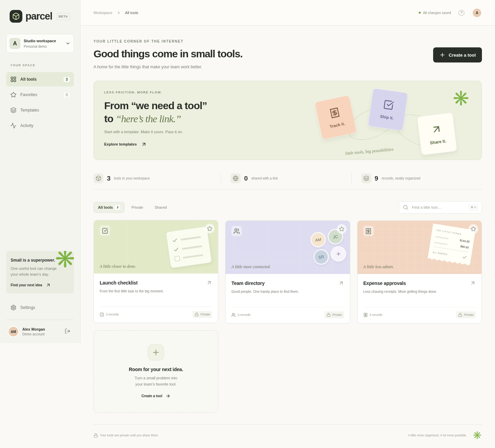

# Parcel

**Small software, shared simply.** A calm home for the little internal tools that make a team work better.

Parcel turns three everyday workflows—expense approvals, team directories, and launch checklists—into private, persistent tools with revocable sharing links. The interface pairs a warm paper palette, playful illustrated covers, and clear controls with real server-side behavior.



## Run locally

Requires Node.js **22.13+** (Node 24 recommended).

```sh
npm ci
npm run build
npm start
```

The server listens on port 3000. Open it in your local browser. Choose **Explore live demo** for an isolated workspace with sample records, or create an account for an empty personal workspace. A demo workspace can be converted into a permanent account in Settings. Demo data persists in the database but a signed-out demo cannot be recovered without first creating an account.

For frontend development, keep `npm start` running and run `npm run dev` in another terminal. Vite proxies `/api` to the application server on port 3000.

```sh
npm test           # isolated database; real HTTP integration tests
npm run build     # production frontend build
```

## What works

- Account creation, sign-in, sign-out, salted scrypt password hashing, seven-day HTTP-only sessions
- Separate workspaces and server-enforced ownership checks
- Three templates with configurable names/descriptions and optional sample data
- Validated create/edit/delete record forms, totals and progress metrics
- Search, favorites, private/shared filters, activity history
- CSV export with spreadsheet formula escaping
- Random view-only links, anonymous viewing, immediate revocation
- Responsive mobile navigation, keyboard search, focus-trapped dialogs, reduced-motion support
- Persistent SQLite storage and production static serving

## Architecture

React 19 + Vite frontend; Express 5 API; Node's built-in SQLite driver. No external database or API keys required. SQLite runs in WAL mode with foreign keys enabled. Records are validated against server-owned template schemas. Shared endpoints omit owner and token fields. All non-read API requests require a custom header; CORS is not enabled, and session cookies are SameSite=Strict. The server sets CSP, frame protection, and no-store headers for API responses.

See [product brief](docs/PRODUCT.md), [deployment guide](docs/DEPLOYMENT.md), and [validation notes](docs/VALIDATION.md).

## Configuration

| Variable        | Default  | Purpose                                     |
| --------------- | -------- | ------------------------------------------- |
| `PORT`          | `3000`   | HTTP listen port                            |
| `DATA_DIR`      | `./data` | Persistent SQLite directory                 |
| `DEMO_ENABLED`  | `1`      | Set `0` to disable new demo workspaces      |
| `COOKIE_SECURE` | unset    | Set `1` behind production HTTPS             |
| `TRUST_PROXY`   | unset    | Set `1` only with one trusted reverse proxy |

Use environment variables directly; this app does not automatically load `.env` files. Never commit databases, credentials, or user records.

## Scope

This is a working first release for personal workspaces and view-only sharing. It does not execute uploaded code, generate tools with AI, send invitations, offer collaborative editing, verify email, recover passwords, bill users, or deploy arbitrary apps. Those require additional infrastructure and product work. Public registration currently creates personal accounts; deployment operators should decide access policy before opening a sensitive internal installation. Demo data is illustrative, not real user information.
